<h1 align="center">ru-drawing-cn-annotator</h1>

<p align="center">
  <b>Russian engineering drawings → bilingual Chinese editions, without touching the original.</b><br>
  俄文工程图纸 → 中文标注版：蓝色中文以矢量叠加在俄文旁，原图一笔不改
</p>

<p align="center">
  <a href="https://github.com/iZHENGjy/ru-drawing-cn-annotator/actions/workflows/tests.yml"></a>
  
  
  <a href="LICENSE"></a>
</p>

<p align="center">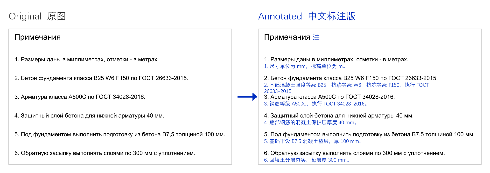</p>

<p align="center">
  <a href="#production-pipeline-one-command">Pipeline</a> · <a href="#cost">Cost</a> · <a href="#demo">Demo</a> · <a href="#how-it-works">How it works</a> · <a href="#quickstart">Quickstart</a> · <a href="#limitations">Limitations</a> · <a href="#中文说明">中文说明</a>
</p>

Drawings made to Russian standards (ГОСТ / СПДС) often have to be handed to Chinese
engineers and contractors. Re-drawing them in Chinese is slow, and machine translation
silently corrupts the numbers, grades and standard references that matter most. This tool
keeps the drawing as it is and **adds** the Chinese: blue vector text next to every Russian
label, note and table cell (PDF), or a separate `CN_TRANSLATION` layer (DWG/DXF). The result
prints as one bilingual sheet.

**Other languages.** The language pair is a project setting (`[project] source_lang` / `target_lang`,
ISO codes): Russian, English, Kazakh, Ukrainian, German, French and Chinese as source or target, e.g.
`ru→zh` (default), `en→zh`, `kk→zh`, `zh→ru`, `zh→en`, `ru→en`. OCR models, fonts, line breaking, prompts,
glossaries (`glossary/<src>-<tgt>/`) and the code guards follow the pair; the layout rules stay the same.
Synthetic demos: `demo/multilang/` (English scan → Chinese, Chinese text layer → English). See
[docs/pipeline.md](docs/pipeline.md#languages).

## Production pipeline (one command)

```bash
pip install -e ".[scan]"                         # from a checkout: installs the `drawtrans` command
drawtrans doctor                                     # check Python deps, Tesseract, font, claude CLI
drawtrans init my_job --pdf vol1.pdf --src ru --tgt zh   # writes project.toml, detects scan vs text layer
cd my_job && drawtrans run                           # sample pages first, then --approve-samples; resumable
```

A drawing set goes in, a printable bilingual PDF, a cost report and a delivery-gate summary come
out. Code does everything that has a right answer: OCR, deduplication, translation memory, mapping
lines to Chinese, placement and checks. The LLM is used only in four narrow tasks, each with a
fixed input packet, a JSON Schema and a validator. Details: [docs/pipeline.md](docs/pipeline.md).

Design of the pipeline (stages, constrained LLM tasks, gates): [docs/design.md](docs/design.md#pipeline-design).

### Sample output (synthetic drawing, scanned route)

These come from `demo/demo_drawing.pdf` rasterised to an image-only "scan" and put through the
pipeline end to end. No client material.

| Scan (input) | Output |
|:-:|:-:|
| 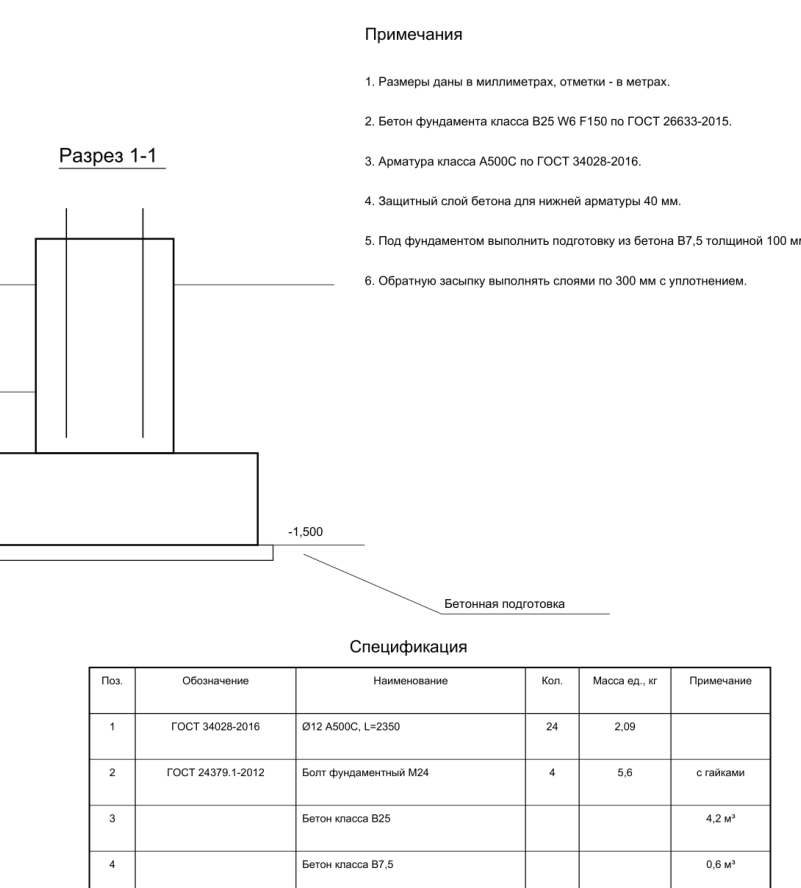 | 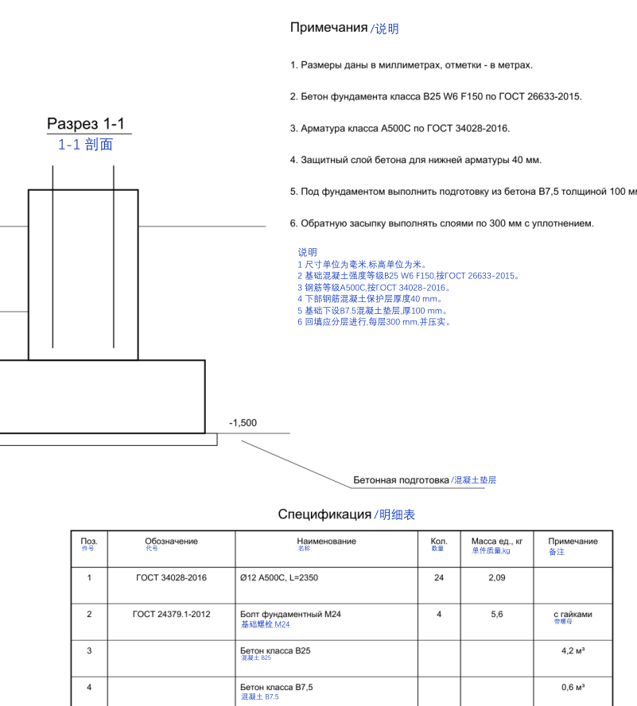 |
| 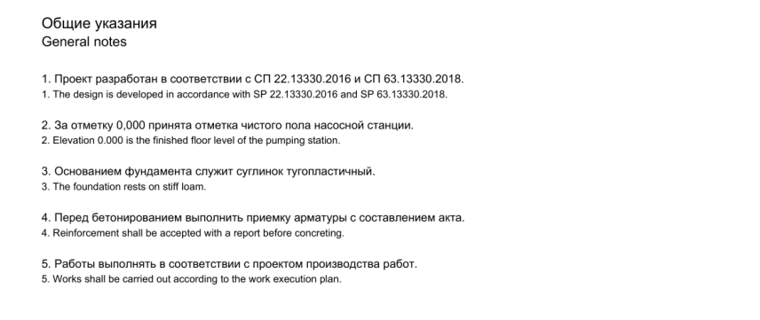 | 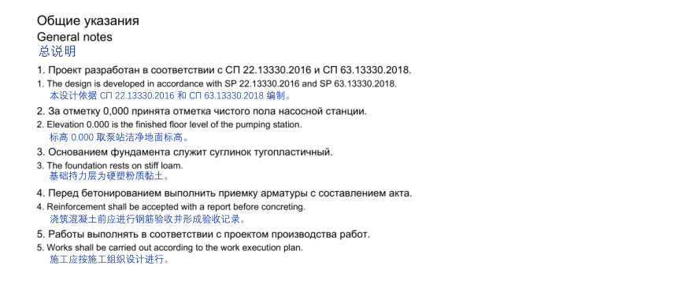 |
| 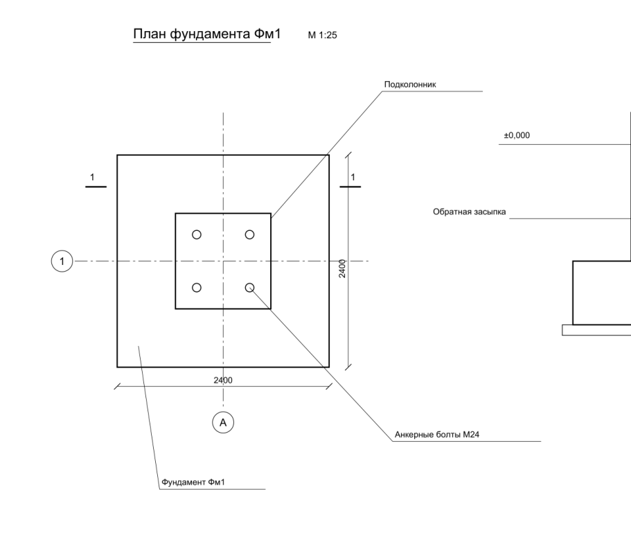 | 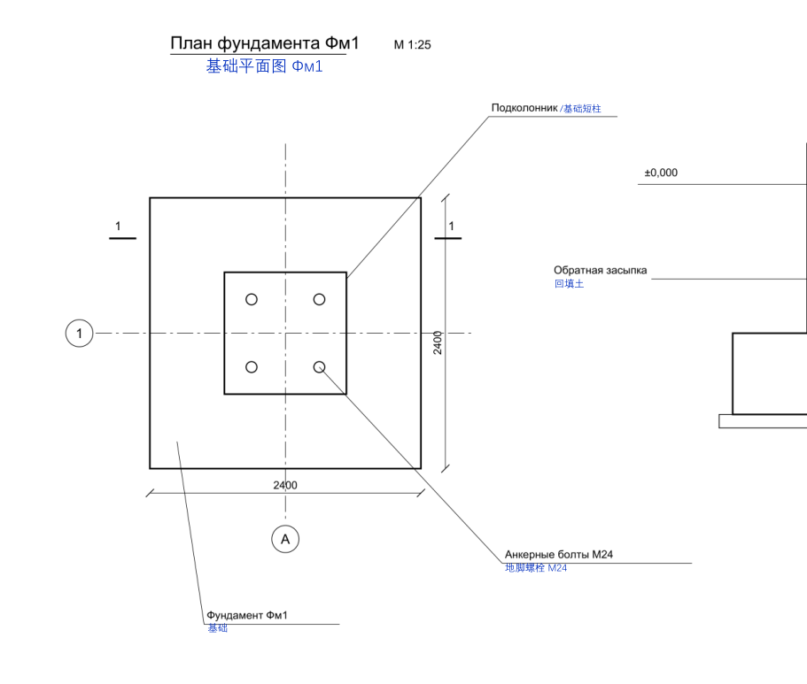 |
| 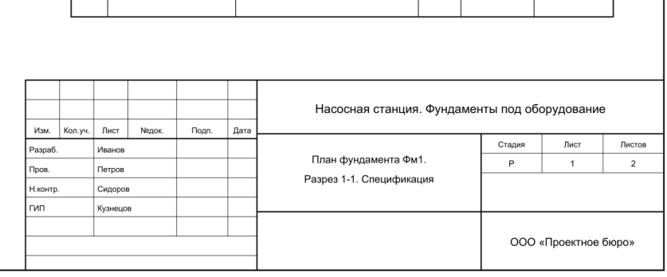 | 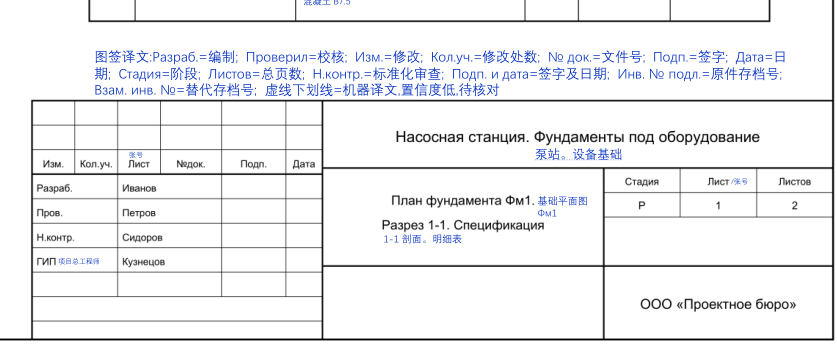 |

Chinese goes directly under the Russian. Numbered notes get a Chinese block with clause numbers,
and on bilingual RU/EN sheets each clause gets its own line. Schedule headers and names are
labelled in their cells. Title-block fields go into one bilingual legend line instead of being
squeezed into the signature cells.

### Cost

Every LLM call is metered (tokens, images, USD) and summarised per stage in
`work/job/cost_report.md`. Measured with Claude via the `claude` CLI, list prices:

| Set | Sheets | phrase_translate | page_notes | audit + visual review | Total | Per sheet |
|---|--:|--:|--:|--:|--:|--:|
| Synthetic demo (above) | 2 | $0.03 | $0.05 | $0.05 | **$0.13** | $0.06 |
| Embedded-items volume, real scans | 26 | $0.17 | $0.35 | $0.26 | **$0.79** | $0.03 |
| RC volume (dense rebar sheets), real scans | 43 | $1.19 | $1.67 | $0.47 | **$3.33** | $0.08 |
| Both real volumes, earlier agent-driven workflow (no pipeline) | 69 | | | | ≈ $94 | ≈ $1.36 |

- **What drives the cost:** `page_notes` (one call per sheet with small crops) and new phrases. A
  volume is deduplicated before anything is sent: 1074 Russian OCR lines became about 320 phrases,
  and the public glossaries already covered about half of those.
- **Re-runs:** identical input replays from the cache for $0.00.
- **Sharing a translation memory:** reusing one volume's memory for the next saves most on
  revisions and volumes of the same kind. Across different kinds (embedded items vs rebar) the
  saving was small.
- **Budget:** `budget_usd` in `project.toml` stops the run before it is exceeded.


## Demo

### 1 · Russian-only sheet: Chinese added, nothing removed

| Original | Annotated (`--english keep`, default) |
|:-:|:-:|
| 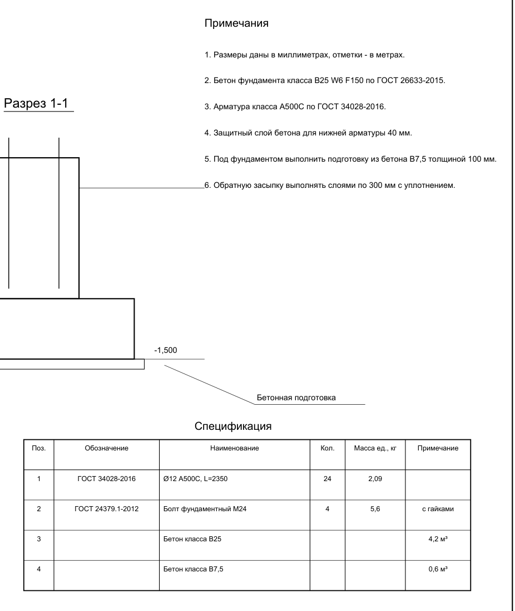 | 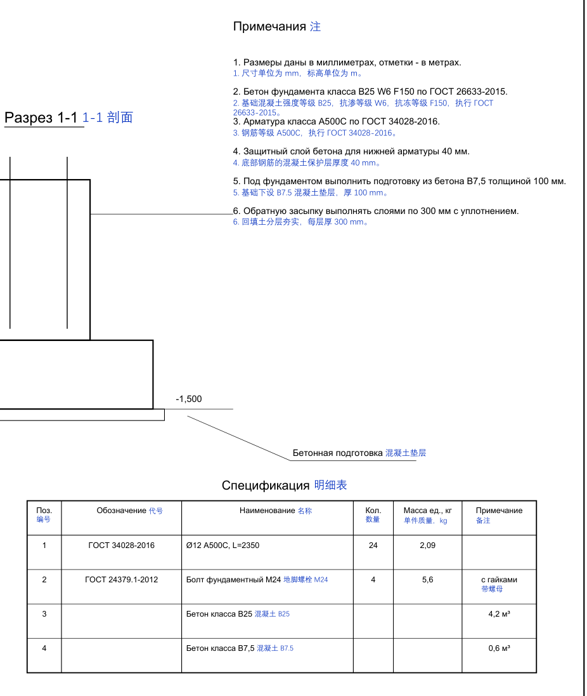 |

Codes such as Фм1, А500С, Ø12 and L=2350 are left alone; ГОСТ numbers and values are carried over.

### 2 · Bilingual RU/EN sheet: the English layer is replaced

| Original | Annotated (`--english replace`) |
|:-:|:-:|
| 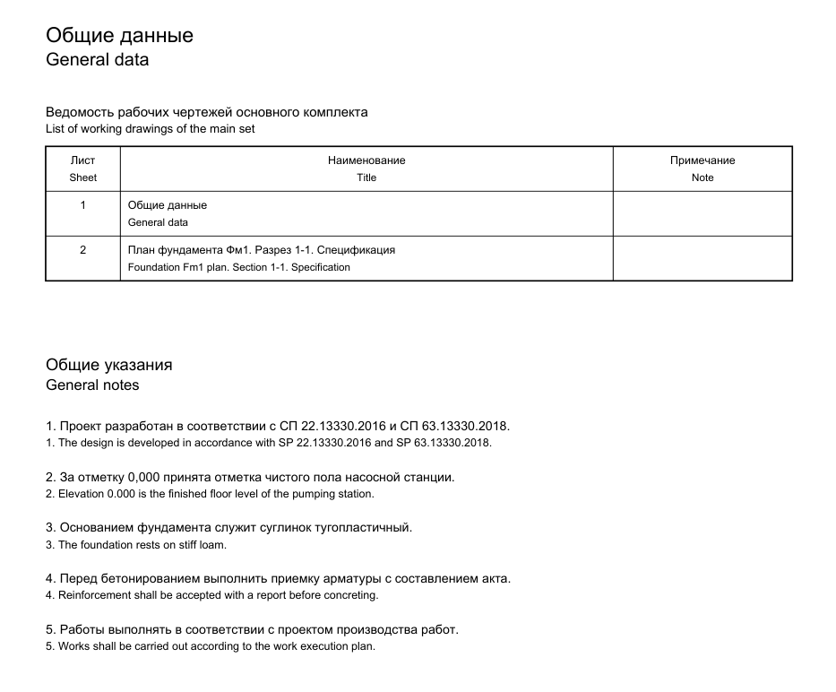 | 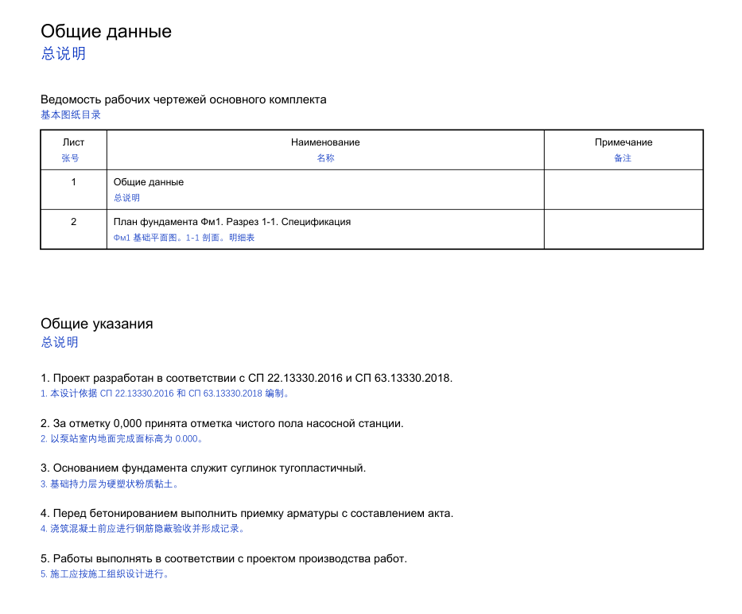 |

### 3 · DWG/DXF: separate `CN_TRANSLATION` layer

<p align="center">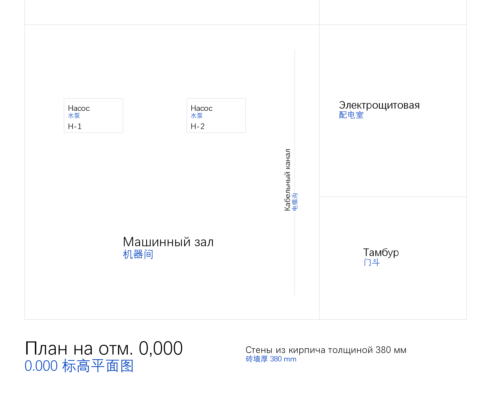</p>

<details>
<summary>Full sheet 1, before and after</summary>

| Original | Annotated |
|:-:|:-:|
| 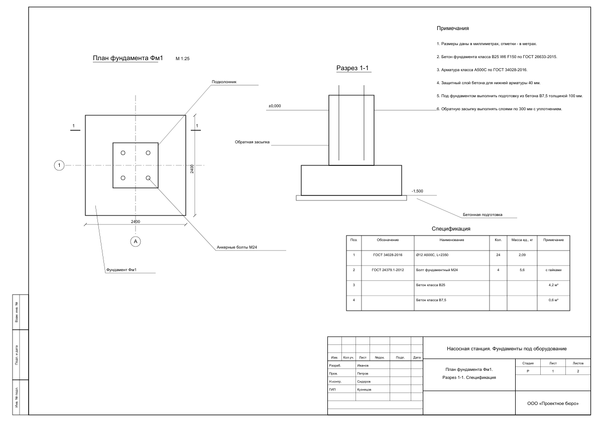 | 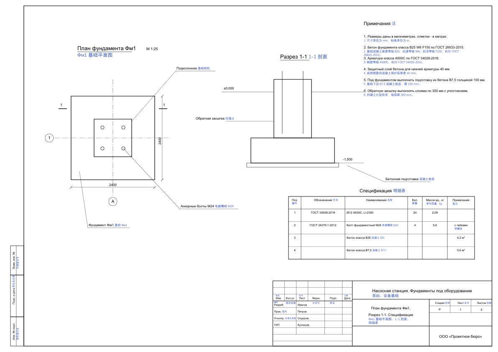 |

</details>

Reproduce everything with `python demo/run_demo.py`.

## How it works

See [docs/design.md](docs/design.md#how-it-works) and the module map in [docs/architecture.md](docs/architecture.md).

## Quickstart

```bash
git clone https://github.com/iZHENGjy/ru-drawing-cn-annotator
cd ru-drawing-cn-annotator
python -m venv .venv
. .venv/bin/activate            # Windows: .venv\Scripts\activate
pip install -r requirements.txt
python demo/run_demo.py         # builds demo/work/output/*.pdf, *.dxf
pytest
```

A Chinese font is picked automatically (DengXian / SimHei / Microsoft YaHei on Windows,
PingFang on macOS, WenQuanYi / Noto CJK on Linux, else PyMuPDF's built-in CJK font).
Override with `RUDRAW_FONT=/path/font.ttf` or `font = ...` in `project.toml`.

### Your own drawings

Keep project material **outside** this repository (or under `projects/`, which is git-ignored).

```bash
mkdir -p ~/work/myjob && cp project.example.toml ~/work/myjob/project.toml   # set pdf = ...
cd ~/work/myjob
R=/path/to/ru-drawing-cn-annotator/scripts

python $R/01_extract.py && python $R/02_lines.py     # survey: text layer? how many unique lines?
python $R/20_build.py all --dry                      # -> review/tm_todo.json
python $R/41_export_todo.py                          # -> review/todo_all.txt (index, key, pages)
# translate into batch.tsv:  <index> TAB <start of key> TAB <Chinese, same ⟨n⟩ placeholders>
python $R/40_merge_tm.py batch.tsv                   # validated; nothing is written on any error
python $R/20_build.py all                            # or: --english replace for RU/EN sheets
python $R/43_issues.py --notes my_findings.md        # -> output/问题清单.md
```

Repeat dry run → translate → merge until `missing TM keys: 0`. The translation step is yours:
a human translator, or an LLM working through `todo_all.txt`; the merge validator rejects any
entry whose placeholders differ from the key or that hard-codes digits.

### DWG / DXF

1. Convert DWG → DXF. Neither converter is shipped here:
   - [ODA File Converter](https://www.opendesign.com/guestfiles/oda_file_converter) (free,
     proprietary) — most faithful, also converts the result back to DWG
     (`scripts/cad/30_to_dwg.ps1`).
   - [LibreDWG](https://www.gnu.org/software/libredwg/) `dwg2dxf` (GPL-3.0) — install it yourself:
     `apt install libredwg-tools`, `brew install libredwg`, or the Windows builds from
     [its releases](https://github.com/LibreDWG/libredwg/releases). Fine for the text census;
     may drop some entities on complex drawings.
2. `python $R/cad/01_census.py --dxf plan.dxf` — what text is there (and whether the code page
   is broken: cp1251 text read as GBK is repaired automatically).
3. `python $R/cad/10_build.py --dxf plan.dxf [--dry]` — same TM loop as for PDF; writes
   `plan_CN.dxf` (full drawing + layer) and `plan_CN_overlay.dxf` (Chinese only, insert at 0,0).
4. `python $R/cad/20_preview.py output/plan_CN.dxf out.png x0 y0 x1 y1` to check a window.

## Limitations

- **The main route needs a text layer.** Scans and AutoCAD exports where text became SHX vector
  strokes have no extractable text (`01_extract.py` tells you). Use the scanned route
  ([docs/scanned.md](docs/scanned.md)) for those: it is OCR-based, so it relies
  on its coverage audit and a human / LLM visual review rather than on exact glyphs.
- **Not machine translation.** Quality is exactly the quality of your translation memory. The
  automatic QA proves completeness, number/standard consistency and clean layout — not that a
  translation is right. Have a domain reviewer check the terms.
- **Heuristics tuned for ГОСТ/СПДС sheets** (horizontal and 90° text, Form 3 title block).
  Text at other angles in PDFs is left alone. Very tight title-block cells end up with small
  Chinese or callouts.
- **Context is only "title block" vs "body".** Words whose meaning depends on anything else
  need a project-level override (the demo overrides «Лист» in a drawing-list table).
- **DXF placement is approximate**: text widths are estimated from character classes, MTEXT
  formatting is flattened, only modelspace is processed.
- Reports and the issue list are in Chinese (the language of the deliverable).

## Repository layout

Code in `src/drawtrans/` (one package per domain), docs in `docs/`, public glossaries in `glossary/<src>-<tgt>/`, synthetic demos in `demo/`. Module map, data flow and extension points: [docs/architecture.md](docs/architecture.md). Contributing: [CONTRIBUTING.md](CONTRIBUTING.md); changes: [CHANGELOG.md](CHANGELOG.md).

## License

MIT for the code in this repository. Note that **PyMuPDF is AGPL-3.0** (or commercial from
Artifex): if you distribute this tool together with PyMuPDF, or offer it as a network service,
the AGPL terms apply to that combination. LibreDWG (GPL) and ODA File Converter are not
included and are only invoked as external programs.

---

## 中文说明

把俄文工程图纸转成**中文标注版**：蓝色中文以矢量文字叠加在每处俄文旁边（PDF），
或放在独立图层 `CN_TRANSLATION` 上（DWG/DXF）。原图的线条、尺寸和俄文**一处不改**，
输出可直接打印的双语图纸。

这套工具来自一次真实的商业图纸翻译工作。
本仓库只包含通用代码，不含任何客户资料；上面的演示图纸是程序生成的虚构图纸。

### 能做什么

- **纯俄文图纸**（默认 `--english keep`）：原图不动，中文放在俄文右侧 / 下方 / 上方的空白处；
  放不下就缩小字号，或加圈号（①②…）引到最近的空白处。
- **俄英双语图纸**（`--english replace`）：逐字形删除英文文字层（线条不动），中文填入英文原来的位置。
- **长篇条文**（总说明）：可在该页后插入中文附页，按原条号对照。
- **DWG/DXF**：中文写在单独图层上，块内文字、旋转文字都能处理；同时输出只含中文的叠加 DXF。
- **自动检查**：俄文是否完整、英文是否删净、数字和 ГОСТ/СП 标准号是否与俄文一致、中文是否压字或出界；
  `43_issues.py` 生成给审核人的问题清单。

### 关键设计

见 [docs/design.md](docs/design.md) 与 [docs/architecture.md](docs/architecture.md)。

### 生产流水线与成本

- **一条命令**:`drawtrans run`(旧入口 `python scripts/rudraw.py run` 仍可用)按阶段跑完一个任务,先出样页。
  - 可断点续跑,每个阶段的产物和日志都落盘。
  - 结束时输出中文对照版 PDF、成本报表(`work/job/cost_report.md`)和交付关卡结果。
- **LLM 只用在 4 处**:新短语翻译、整页标题与说明、审计复核、看图复核(只看 QA 标出的可疑区域)。
  - 每处都有固定输入、JSON Schema 和代码校验,数字、代号、钢号、标准号对不上就拒收。
  - 去重、查翻译记忆、行与译文的对应、排版、检查,全部由代码完成。
- **稳定**:LLM 回答都进缓存,同一输入重跑,输出逐字节一致、0 费用。
- **实测成本**:

| 图册 | 页数 | 每页成本 |
|---|--:|--:|
| 合成演示 | 2 | $0.06 |
| 真实扫描件,预埋件册 | 26 | $0.03 |
| 真实扫描件,配筋册 | 43 | $0.08 |
| 改造前(两册合计,靠 agent 临场处理) | 69 | 约 $1.36 |

- 样品图与流程图见上文 [Production pipeline](#production-pipeline-one-command);样品全部来自合成图纸,不含任何客户资料。

### 快速开始

```bash
git clone https://github.com/iZHENGjy/ru-drawing-cn-annotator
cd ru-drawing-cn-annotator
python -m venv .venv
.venv\Scripts\activate          # macOS/Linux: . .venv/bin/activate
pip install -r requirements.txt
python demo/run_demo.py
pytest
```

自己的项目：复制 `project.example.toml` 到项目文件夹（放在本仓库之外），填好 PDF 路径，然后按
"试运行 → 导出待译清单 → 翻译 → 合并校验 → 正式生成"循环，直到 `missing TM keys: 0`。命令见上文英文部分。

DWG 需先转成 DXF：推荐 ODA File Converter（免费，非开源），或自行安装 LibreDWG 的 `dwg2dxf`（GPL，本仓库不附带）。

### 局限

- 主流程要求 PDF 有文字层。扫描件请走扫描件流程(docs/scanned.md)（Tesseract + RapidOCR 双检测、
  覆盖率核对必须为 0、构件代号校验、逐页看图复核），说明见 [docs/scanned.md](docs/scanned.md)。
- 不是机器翻译：译文质量取决于翻译记忆库。自动检查只能证明"不漏、不错数字、不压字"，不能证明译得对，术语需要专业人员审定。
- 版面规则针对 ГОСТ/СПДС 图纸（水平和 90° 文字、3 号图签）；图签格子很窄时中文会很小或改用圈号。
- 上下文只区分"图签 / 正文"两种，其他多义情况需要在项目词库里单独覆盖。
- DXF 中文字宽为估算值，位置是近似的；只处理模型空间。

### 许可

本仓库代码采用 MIT 许可。注意依赖 PyMuPDF 为 AGPL-3.0：如与 PyMuPDF 一起分发或作为网络服务提供，组合作品适用 AGPL 条款。
LibreDWG（GPL）与 ODA File Converter 未随附，只作为外部程序调用。
