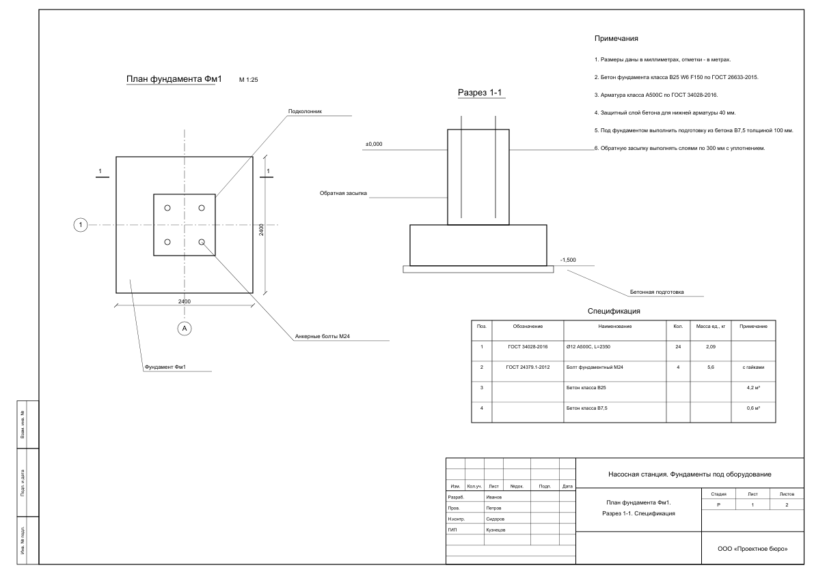
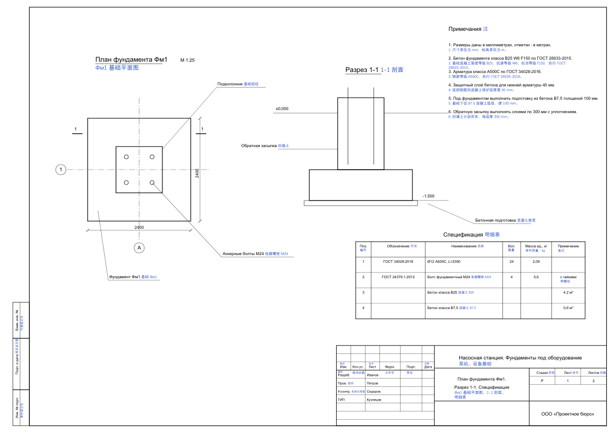
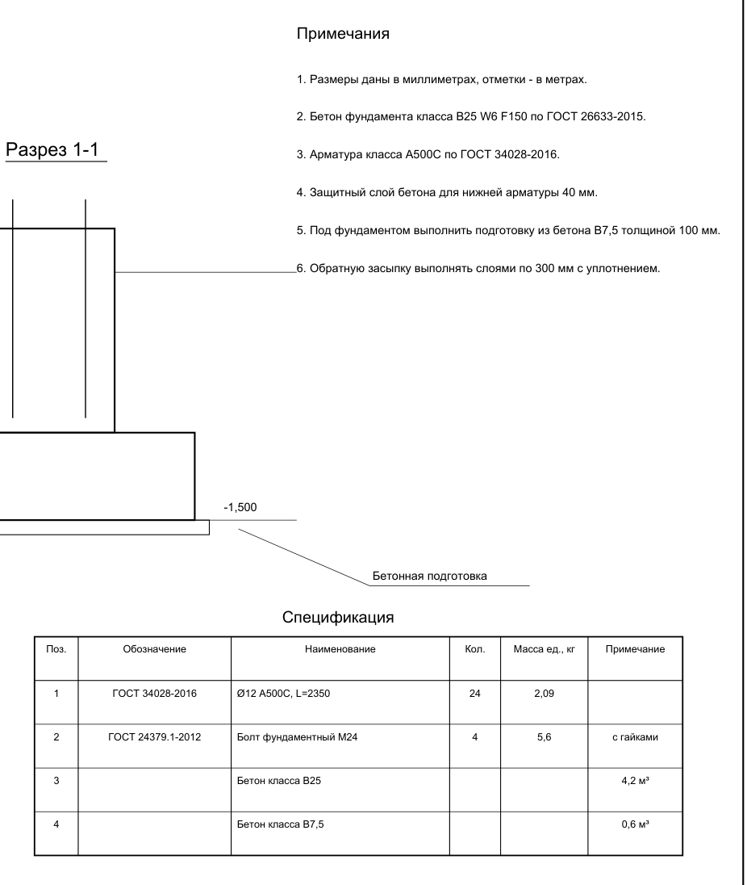
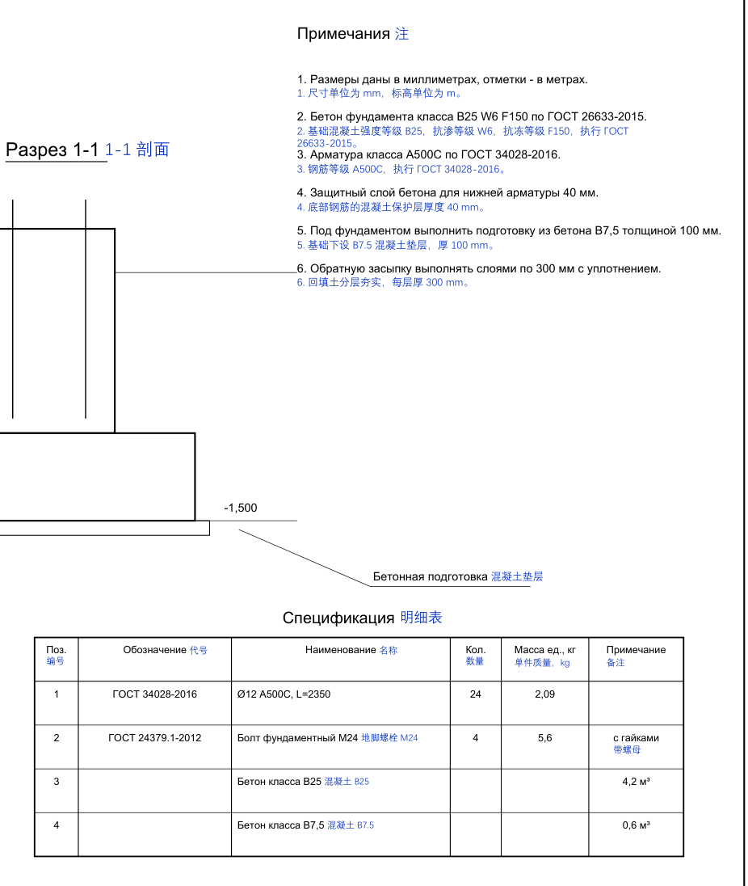
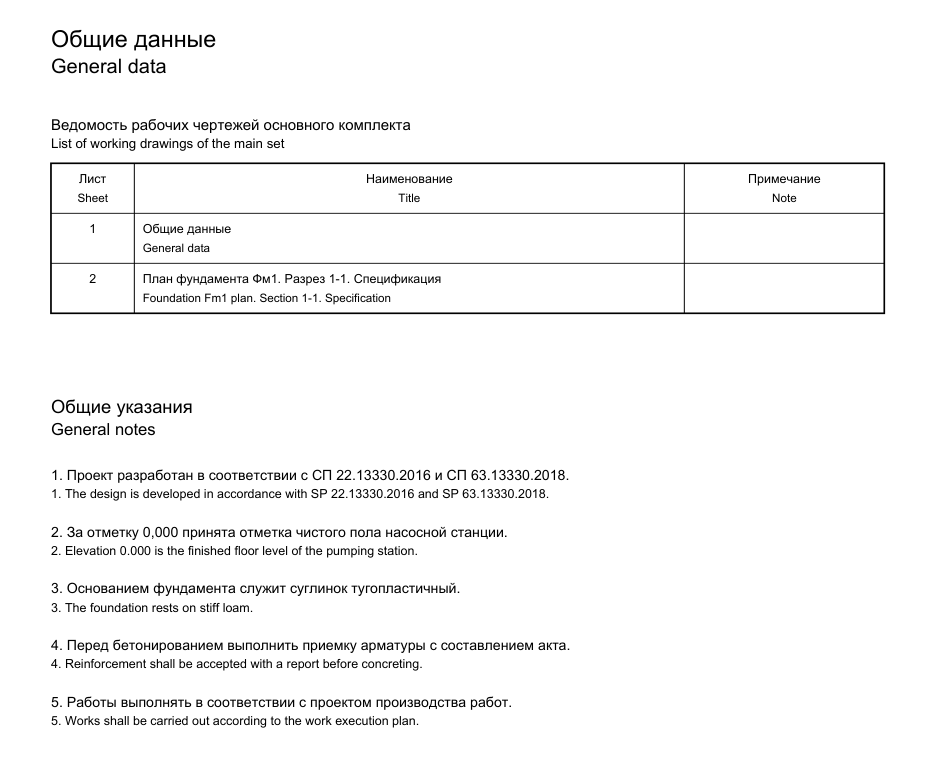
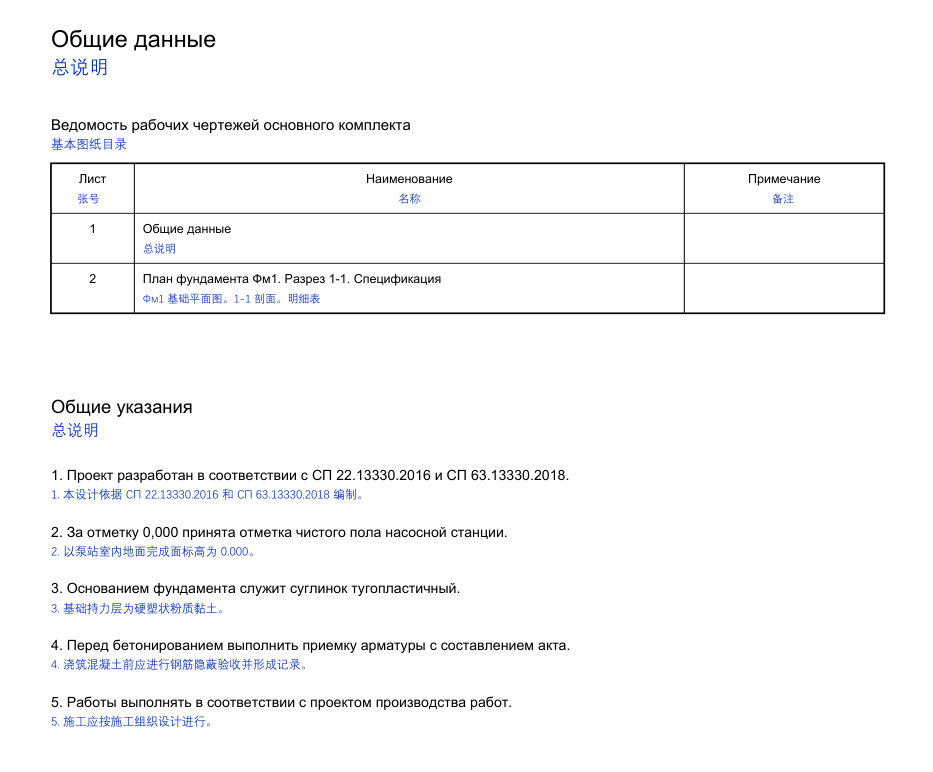
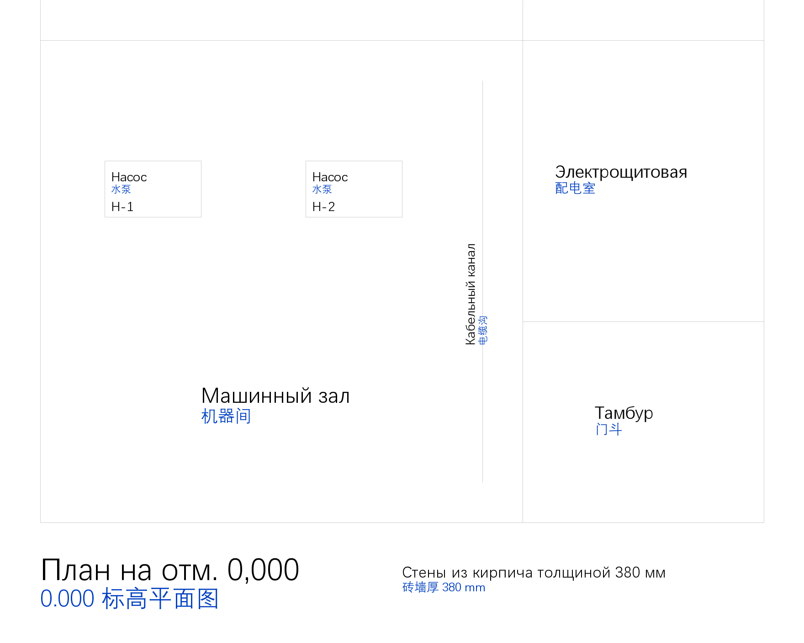
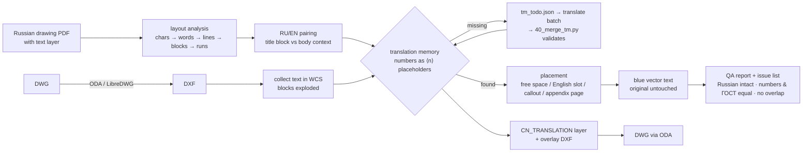

# ru-drawing-cn-annotator

[](https://github.com/iZHENGjy/ru-drawing-cn-annotator/actions/workflows/tests.yml)

**English** · [中文](#中文说明)

Put Chinese translations on Russian engineering drawings **without touching the original**.
The Chinese is drawn as blue vector text next to each Russian label, note and table cell
(PDF), or on its own `CN_TRANSLATION` layer (DWG/DXF). The result is a printable bilingual
drawing in which every original line, dimension and Russian word is exactly where it was.

Built for a real Russian → Chinese job on a 100+-page reinforced-concrete (КЖ) drawing album
and a site-plan DWG. This repository holds only the generic tooling; the demo drawings
below are synthetic.

## Demo

**Sheet 1 – Russian-only foundation drawing** (`--english keep`, the default: nothing is removed)

| before | after |
|---|---|
|  |  |

Close-up of the notes and the specification table — numbers, ГОСТ references, rebar grades
and codes (Фм1, А500С, Ø12) are carried over from the Russian, never re-typed:




**Sheet 2 – bilingual RU/EN sheet** (`--english replace`: the English text layer is removed
glyph by glyph and the Chinese takes its slot; Russian and line art stay)

| before | after |
|---|---|
|  |  |

**DWG/DXF** – Chinese added on layer `CN_TRANSLATION` (blue), including text inside blocks
and rotated text; an overlay-only DXF is written as well:



Reproduce everything with `python demo/run_demo.py`.

## How it works



- **Layout analysis** (`scripts/engine/layout.py`) rebuilds lines, paragraphs and table cells
  from PyMuPDF glyphs, in a rotated frame for vertical text, and uses the drawing's own line art
  (table rules) to keep cells apart. Every word gets a language: Russian, English or *neutral*
  (numbers, codes, units, standards, names).
- **Translation memory** (`scripts/engine/tm.py`) keys are normalised Russian with every number
  replaced by a placeholder, so `Бетон класса B25` and `Бетон класса B30` share one entry and the
  numbers in the output always come from the source. Decimal commas become points, except inside
  codes. Ambiguous words get per-context entries (`@tb|Лист` = sheet no. in the title block,
  `@body|Лист` = steel plate elsewhere). A small generic ГОСТ/СПДС glossary is included.
- **Placement** (`scripts/engine/place.py`, `pdf_build.py`) tries, in order: the slot of the
  removed English (replace mode), free space right / below / above / left of the Russian, a
  smaller font, a numbered callout (①②…) in the nearest free area, or — for dense numbered
  notes — an inserted Chinese page after the sheet. Chinese is wrapped with jieba word
  segmentation, so a line never breaks inside a word, and closing punctuation never starts a line.
- **QA** on every page: Russian word count unchanged, no English left (replace mode), numbers
  and standard numbers in the Chinese equal to the Russian, no Chinese over original text or
  over other Chinese, nothing off the page. `43_issues.py` turns this into a reviewer's list.

## Quickstart

```bash
git clone https://github.com/iZHENGjy/ru-drawing-cn-annotator
cd ru-drawing-cn-annotator
python -m venv .venv
. .venv/bin/activate            # Windows: .venv\Scripts\activate
pip install -r requirements.txt
python demo/run_demo.py         # builds demo/work/output/*.pdf, *.dxf
pytest
```

A Chinese font is picked automatically (DengXian / SimHei / Microsoft YaHei on Windows,
PingFang on macOS, WenQuanYi / Noto CJK on Linux, else PyMuPDF's built-in CJK font).
Override with `RUDRAW_FONT=/path/font.ttf` or `font = ...` in `project.toml`.

### Your own drawings

Keep project material **outside** this repository (or under `projects/`, which is git-ignored).

```bash
mkdir -p ~/work/myjob && cp project.example.toml ~/work/myjob/project.toml   # set pdf = ...
cd ~/work/myjob
R=/path/to/ru-drawing-cn-annotator/scripts

python $R/01_extract.py && python $R/02_lines.py     # survey: text layer? how many unique lines?
python $R/20_build.py all --dry                      # -> review/tm_todo.json
python $R/41_export_todo.py                          # -> review/todo_all.txt (index, key, pages)
# translate into batch.tsv:  <index> TAB <start of key> TAB <Chinese, same ⟨n⟩ placeholders>
python $R/40_merge_tm.py batch.tsv                   # validated; nothing is written on any error
python $R/20_build.py all                            # or: --english replace for RU/EN sheets
python $R/43_issues.py --notes my_findings.md        # -> output/问题清单.md
```

Repeat dry run → translate → merge until `missing TM keys: 0`. The translation step is yours:
a human translator, or an LLM working through `todo_all.txt`; the merge validator rejects any
entry whose placeholders differ from the key or that hard-codes digits.

### DWG / DXF

1. Convert DWG → DXF. Neither converter is shipped here:
   - [ODA File Converter](https://www.opendesign.com/guestfiles/oda_file_converter) (free,
     proprietary) — most faithful, also converts the result back to DWG
     (`scripts/cad/30_to_dwg.ps1`).
   - [LibreDWG](https://www.gnu.org/software/libredwg/) `dwg2dxf` (GPL-3.0) — install it yourself:
     `apt install libredwg-tools`, `brew install libredwg`, or the Windows builds from
     [its releases](https://github.com/LibreDWG/libredwg/releases). Fine for the text census;
     may drop some entities on complex drawings.
2. `python $R/cad/01_census.py --dxf plan.dxf` — what text is there (and whether the code page
   is broken: cp1251 text read as GBK is repaired automatically).
3. `python $R/cad/10_build.py --dxf plan.dxf [--dry]` — same TM loop as for PDF; writes
   `plan_CN.dxf` (full drawing + layer) and `plan_CN_overlay.dxf` (Chinese only, insert at 0,0).
4. `python $R/cad/20_preview.py output/plan_CN.dxf out.png x0 y0 x1 y1` to check a window.

## Limitations

- **Needs a text layer.** Scans and AutoCAD exports where text became SHX vector strokes have
  no extractable text; run OCR first (not included). `01_extract.py` tells you.
- **Not machine translation.** Quality is exactly the quality of your translation memory. The
  automatic QA proves completeness, number/standard consistency and clean layout — not that a
  translation is right. Have a domain reviewer check the terms.
- **Heuristics tuned for ГОСТ/СПДС sheets** (horizontal and 90° text, Form 3 title block).
  Text at other angles in PDFs is left alone. Very tight title-block cells end up with small
  Chinese or callouts.
- **Context is only "title block" vs "body".** Words whose meaning depends on anything else
  need a project-level override (the demo overrides «Лист» in a drawing-list table).
- **DXF placement is approximate**: text widths are estimated from character classes, MTEXT
  formatting is flattened, only modelspace is processed.
- Reports and the issue list are in Chinese (the language of the deliverable).

## Repository layout

```
scripts/
  engine/            layout.py · place.py · tm.py · pdf_build.py · config.py
  01_extract.py      survey: words per page + census          02_lines.py   unique Russian lines
  05_volume.py       volume per section                        06_probe_layout.py  dump lines of a page
  20_build.py        build the Chinese PDF                     30_preview.py  render a page / clip
  40_merge_tm.py     merge a translated batch (validated)      41_export_todo.py   todo list
  42_debug_pairs.py  RU/EN pairing diagnostics                 43_issues.py   reviewer's issue list
  cad/               collect.py · 01_census · 02_blocks · 03_dump_wcs · 04_overview
                     10_build (DXF layer + overlay) · 20_preview · 30_to_dwg.ps1 (ODA)
glossary/            gost_general.json – generic title-block / СПДС glossary
demo/                synthetic drawing + DXF generators, demo TM, run_demo.py
tests/               pytest: TM, layout, wrapping, obstacle test, end-to-end no-overlap
```

## License

MIT for the code in this repository. Note that **PyMuPDF is AGPL-3.0** (or commercial from
Artifex): if you distribute this tool together with PyMuPDF, or offer it as a network service,
the AGPL terms apply to that combination. LibreDWG (GPL) and ODA File Converter are not
included and are only invoked as external programs.

---

## 中文说明

把俄文工程图纸转成**中文标注版**：蓝色中文以矢量文字叠加在每处俄文旁边（PDF），
或放在独立图层 `CN_TRANSLATION` 上（DWG/DXF）。原图的线条、尺寸和俄文**一处不改**，
输出可直接打印的双语图纸。

这套工具来自一次真实的俄译中项目（100 多页的钢筋混凝土 КЖ 图册和一张总平面 DWG）。
本仓库只包含通用代码，不含任何客户资料；上面的演示图纸是程序生成的虚构图纸。

### 能做什么

- **纯俄文图纸**（默认 `--english keep`）：原图不动，中文放在俄文右侧 / 下方 / 上方的空白处；
  放不下就缩小字号，或加圈号（①②…）引到最近的空白处。
- **俄英双语图纸**（`--english replace`）：逐字形删除英文文字层（线条不动），中文填入英文原来的位置。
- **长篇条文**（总说明）：可在该页后插入中文附页，按原条号对照。
- **DWG/DXF**：中文写在单独图层上，块内文字、旋转文字都能处理；同时输出只含中文的叠加 DXF。
- **自动检查**：俄文是否完整、英文是否删净、数字和 ГОСТ/СП 标准号是否与俄文一致、中文是否压字或出界；
  `43_issues.py` 生成给审核人的问题清单。

### 关键设计

- **翻译记忆库，数字用占位符**：`Бетон класса B25` 的键是 `Бетон класса B⟨1⟩`，译文里的数字永远从原文取，
  不会被翻译改错；小数逗号自动改小数点，代号中的逗号保留。
- **按位置区分多义词**：`@tb|Лист`（图签里是"张号"）与 `@body|Лист`（正文里是"钢板"）。
- **中文按词换行**（jieba 分词），句末标点不出现在行首；数字、代号、标准号整体不拆。
- 自带一份通用 ГОСТ/СПДС 图签与常用术语词表（`glossary/gost_general.json`），项目词库叠加在上面。

### 快速开始

```bash
git clone https://github.com/iZHENGjy/ru-drawing-cn-annotator
cd ru-drawing-cn-annotator
python -m venv .venv
.venv\Scripts\activate          # macOS/Linux: . .venv/bin/activate
pip install -r requirements.txt
python demo/run_demo.py
pytest
```

自己的项目：复制 `project.example.toml` 到项目文件夹（放在本仓库之外），填好 PDF 路径，然后按
"试运行 → 导出待译清单 → 翻译 → 合并校验 → 正式生成"循环，直到 `missing TM keys: 0`。命令见上文英文部分。

DWG 需先转成 DXF：推荐 ODA File Converter（免费，非开源），或自行安装 LibreDWG 的 `dwg2dxf`（GPL，本仓库不附带）。

### 局限

- PDF 必须有文字层；扫描件或 SHX 线条文字需要先 OCR（不含在本仓库）。
- 不是机器翻译：译文质量取决于翻译记忆库。自动检查只能证明"不漏、不错数字、不压字"，不能证明译得对，术语需要专业人员审定。
- 版面规则针对 ГОСТ/СПДС 图纸（水平和 90° 文字、3 号图签）；图签格子很窄时中文会很小或改用圈号。
- 上下文只区分"图签 / 正文"两种，其他多义情况需要在项目词库里单独覆盖。
- DXF 中文字宽为估算值，位置是近似的；只处理模型空间。

### 许可

本仓库代码采用 MIT 许可。注意依赖 PyMuPDF 为 AGPL-3.0：如与 PyMuPDF 一起分发或作为网络服务提供，组合作品适用 AGPL 条款。
LibreDWG（GPL）与 ODA File Converter 未随附，只作为外部程序调用。
