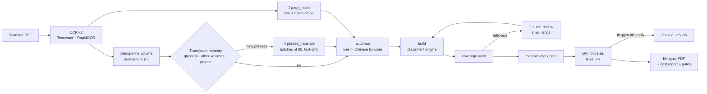
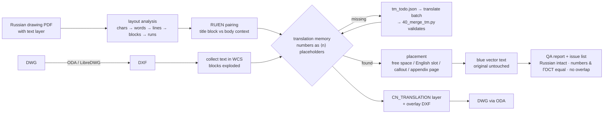

# Design notes

Moved from the README (which now only covers use and results). The module map is in [architecture.md](architecture.md).

## Pipeline design



| Guard rail | How |
|---|---|
| Numbers | Stored as `⟨n⟩` placeholders; a number enters the Chinese only when both OCR engines read it the same way |
| Member marks (Км1.2, МН4) | Never fuzzy-matched; OCR letter swaps and dropped dots corrected against the sheet titles; the gate fails on any unknown mark |
| LLM answers | JSON Schema + validator (placeholders, digits, marks, grades, standards); a rejected answer is retried, never used |
| Coverage | Every Russian box found by either OCR engine must end up translated, in the legend, or explicitly accepted |
| Repeatability | Every LLM answer is cached; re-running the same input gives a byte-identical PDF at zero cost |


## Highlights

- **Original untouched** – Chinese is an added layer; every line, dimension and Russian word
  stays where it was, and that is checked on every page.
- **Numbers cannot be mistranslated** – the translation memory stores numbers as `⟨n⟩`
  placeholders, so values, ГОСТ/СП numbers, concrete and rebar grades always come from the source.
- **Layout-aware placement** – rebuilds paragraphs and table cells from the drawing's own rules,
  finds free space, wraps Chinese by word (jieba), shrinks or uses numbered callouts when space is tight.
- **Bilingual RU/EN sheets** – optionally removes only the English text layer, glyph by glyph,
  and sets the Chinese in its place.
- **DWG/DXF as well** – text inside blocks and rotated text included; an overlay DXF to insert at 0,0.
- **Scanned PDFs too** – a separate OCR route (Tesseract + RapidOCR) with a coverage audit that
  proves every detected Russian text region got its Chinese, and a page-by-page visual review
  loop; see [docs/scanned.md](docs/scanned.md).
- **QA you can hand to a reviewer** – per-page checks plus an issue list.

Developed on a real commercial translation job. No client material is included: every
drawing in this repository is synthetic.


## How it works



- **Layout analysis** (`scripts/engine/layout.py`) rebuilds lines, paragraphs and table cells
  from PyMuPDF glyphs, in a rotated frame for vertical text, and uses the drawing's own line art
  (table rules) to keep cells apart. Every word gets a language: Russian, English or *neutral*
  (numbers, codes, units, standards, names).
- **Translation memory** (`scripts/engine/tm.py`) keys are normalised Russian with every number
  replaced by a placeholder, so `Бетон класса B25` and `Бетон класса B30` share one entry and the
  numbers in the output always come from the source. Decimal commas become points, except inside
  codes. Ambiguous words get per-context entries (`@tb|Лист` = sheet no. in the title block,
  `@body|Лист` = steel plate elsewhere). A small generic ГОСТ/СПДС glossary is included.
- **Placement** (`scripts/engine/place.py`, `pdf_build.py`) tries, in order: the slot of the
  removed English (replace mode), free space right / below / above / left of the Russian, a
  smaller font, a numbered callout (①②…) in the nearest free area, or — for dense numbered
  notes — an inserted Chinese page after the sheet. Chinese is wrapped with jieba word
  segmentation, so a line never breaks inside a word, and closing punctuation never starts a line.
- **QA** on every page: Russian word count unchanged, no English left (replace mode), numbers
  and standard numbers in the Chinese equal to the Russian, no Chinese over original text or
  over other Chinese, nothing off the page. `43_issues.py` turns this into a reviewer's list.


## Repository layout

```
scripts/
  engine/            layout.py · place.py · tm.py · pdf_build.py · config.py
  01_extract.py      survey: words per page + census          02_lines.py   unique Russian lines
  05_volume.py       volume per section                        06_probe_layout.py  dump lines of a page
  20_build.py        build the Chinese PDF                     30_preview.py  render a page / clip
  40_merge_tm.py     merge a translated batch (validated)      41_export_todo.py   todo list
  42_debug_pairs.py  RU/EN pairing diagnostics                 43_issues.py   reviewer's issue list
  cad/               collect.py · 01_census · 02_blocks · 03_dump_wcs · 04_overview
                     10_build (DXF layer + overlay) · 20_preview · 30_to_dwg.ps1 (ODA)
  scan/              scanned PDFs: ctx · engine · 10_ocr · 11_rapid · 12_preview · 20_build
                     30_audit · 31_apply_audit · 40_tiles · 41_apply_visual · 50_check
docs/scanned.md      scanned route: pipeline, delivery gates, lessons from a real set
docs/scanned/        prompts for translators and reviewers (translate, map, audit, visual)
glossary/            gost_general.json – generic title-block / СПДС glossary
demo/                synthetic drawing + DXF generators, demo TM, run_demo.py
tests/               pytest: TM, layout, wrapping, obstacle test, end-to-end no-overlap,
                     scanned route end-to-end (synthetic scan, audit, mark gate)
```


## 关键设计

- **翻译记忆库，数字用占位符**：`Бетон класса B25` 的键是 `Бетон класса B⟨1⟩`，译文里的数字永远从原文取，
  不会被翻译改错；小数逗号自动改小数点，代号中的逗号保留。
- **按位置区分多义词**：`@tb|Лист`（图签里是"张号"）与 `@body|Лист`（正文里是"钢板"）。
- **中文按词换行**（jieba 分词），句末标点不出现在行首；数字、代号、标准号整体不拆。
- 自带一份通用 ГОСТ/СПДС 图签与常用术语词表（`glossary/gost_general.json`），项目词库叠加在上面。

